

<a href="README.md">Español</a> · <b>English</b>

<a href="https://virtuanista.github.io/en/"><picture><source media="(prefers-reduced-motion: reduce)" srcset="img/virtuanista-fija.webp"></picture></a>

### Development · Technology · Artificial Intelligence

Explore my projects, technologies, developments, latest progress and next tasks.

## 🎮 Featured

Newest to oldest.

<a href="https://virtuanista.github.io/vision/">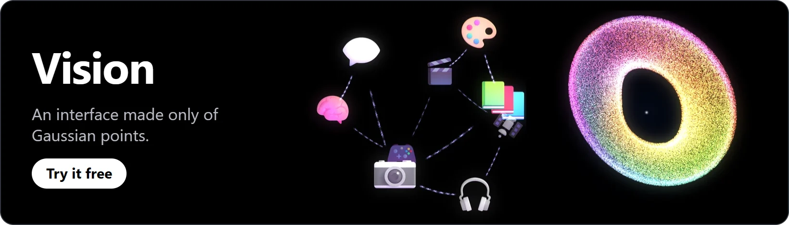</a>

 

<a href="https://virtuanista.github.io/parkour-template/"><picture><source media="(prefers-color-scheme: dark)" srcset="img/parkour-oscuro-en.webp">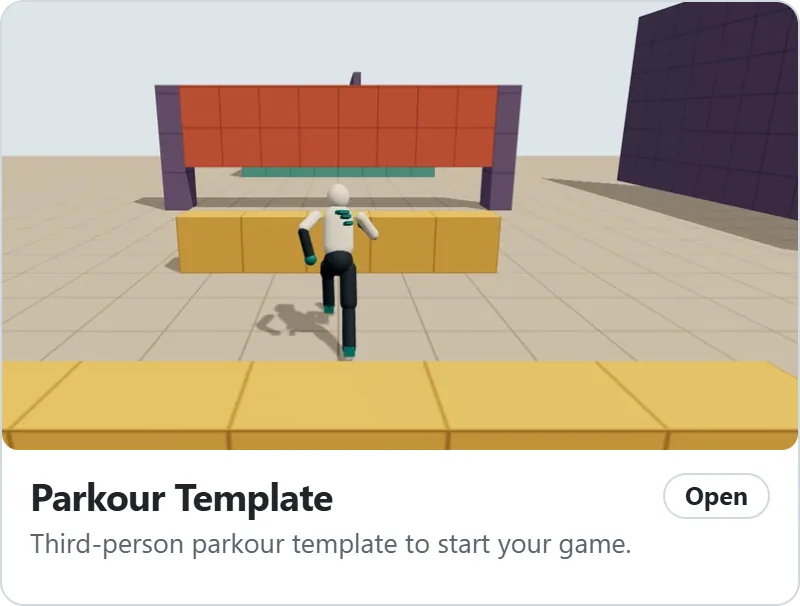</picture></a>
<a href="https://virtuanista.github.io/ceniza-protocolo-bastion/"><picture><source media="(prefers-color-scheme: dark)" srcset="img/ceniza-oscuro-en.webp">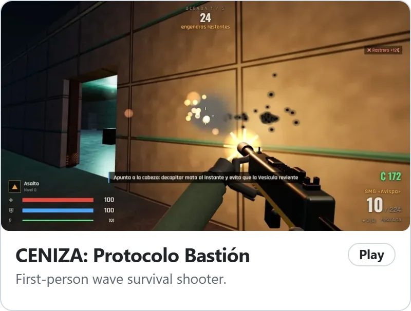</picture></a>
<a href="https://virtuanista.github.io/retro-fantasy-shooter/"><picture><source media="(prefers-color-scheme: dark)" srcset="img/retro-oscuro-en.webp">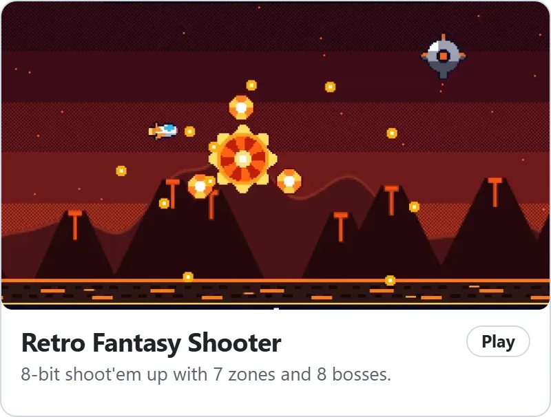</picture></a>
<a href="https://virtuanista.github.io/myrmex/"><picture><source media="(prefers-color-scheme: dark)" srcset="img/myrmex-oscuro-en.webp">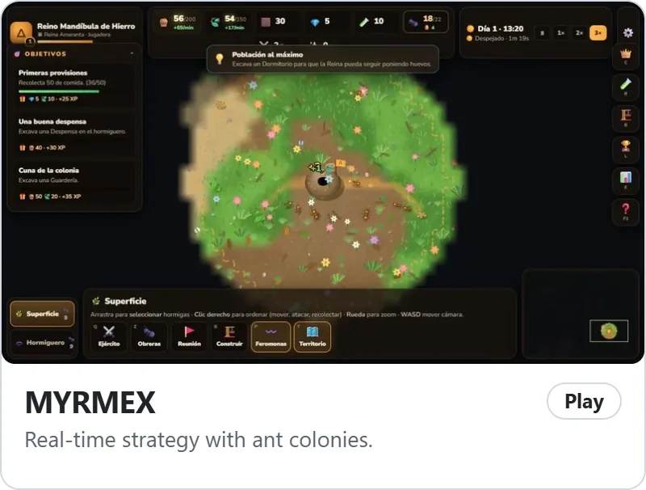</picture></a>
<a href="https://virtuanista.github.io/isleta/"><picture><source media="(prefers-color-scheme: dark)" srcset="img/isleta-oscuro-en.webp">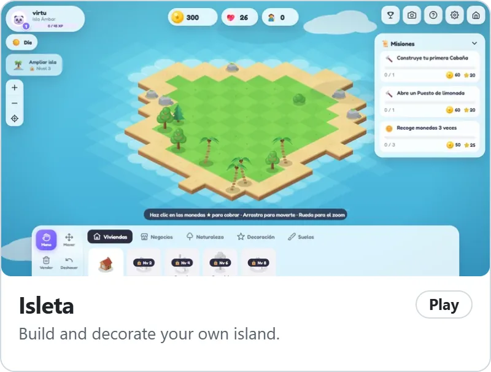</picture></a>
<a href="https://github.com/virtuanista/neon-arena"><picture><source media="(prefers-color-scheme: dark)" srcset="img/neon-oscuro-en.webp">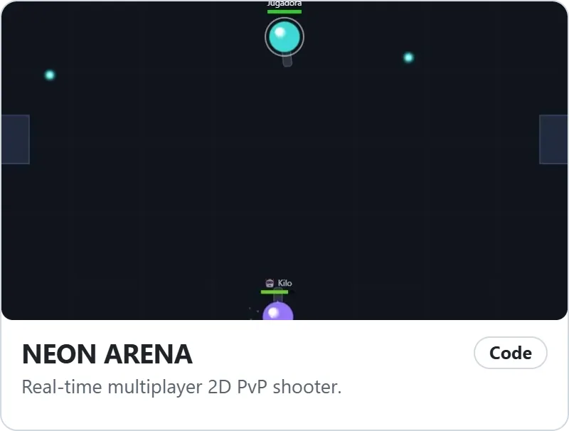</picture></a>

## 🧊 Tools, AI and 3D

<a href="https://virtuanista.github.io/data-miner/?lang=en"><picture><source media="(prefers-color-scheme: dark)" srcset="img/dataminer-oscuro-en.webp">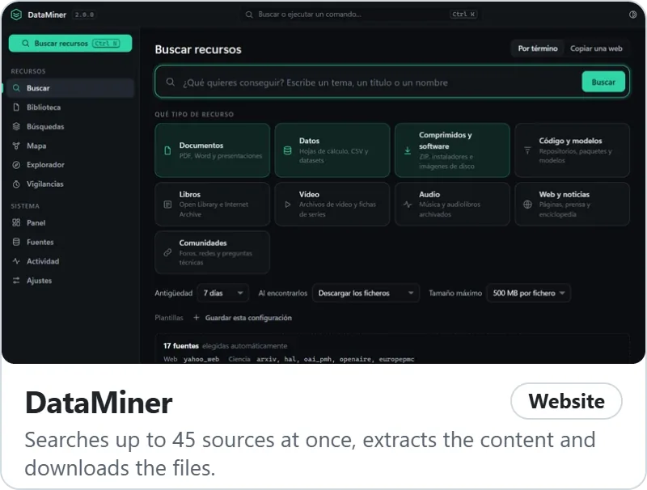</picture></a>
<a href="https://virtuanista.github.io/knowledge-atlas/"><picture><source media="(prefers-color-scheme: dark)" srcset="img/atlas-oscuro-en.webp">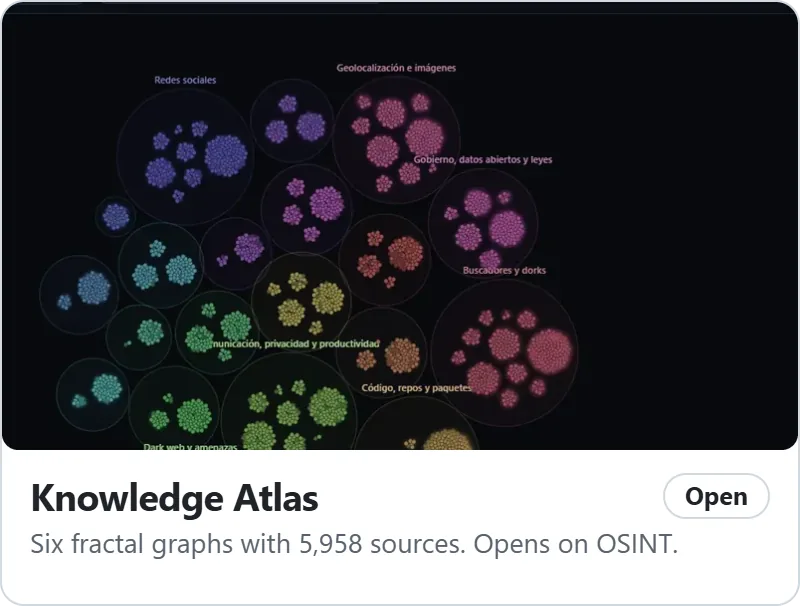</picture></a>
<a href="https://vxtop.github.io/prisma/?lang=en"><picture><source media="(prefers-color-scheme: dark)" srcset="img/prisma-oscuro-en.webp">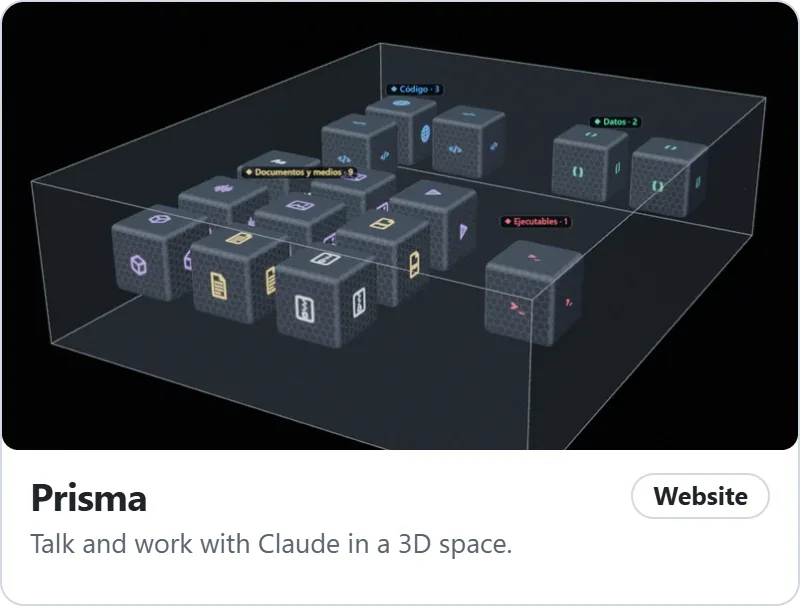</picture></a>
<a href="https://github.com/virtuanista/gamehub"><picture><source media="(prefers-color-scheme: dark)" srcset="img/gamehub-oscuro-en.webp">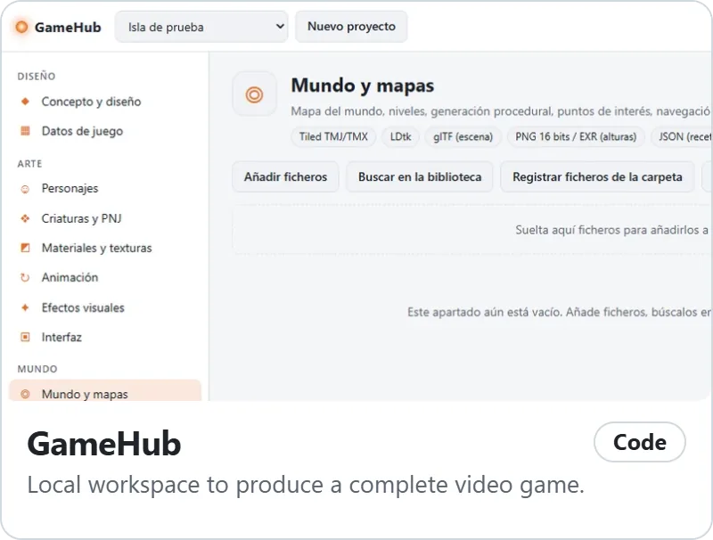</picture></a>
<a href="https://vxtop.github.io/"><picture><source media="(prefers-color-scheme: dark)" srcset="img/vxtop-oscuro-en.webp">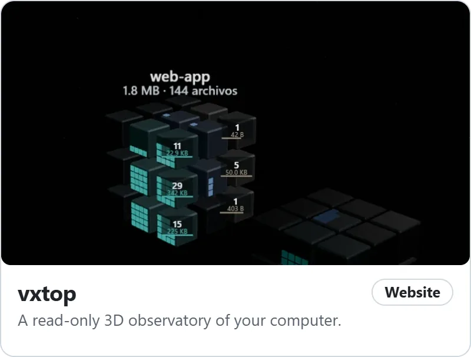</picture></a>
<a href="https://github.com/soniditos/soniditos-desktop/releases/latest"><picture><source media="(prefers-color-scheme: dark)" srcset="img/soniditos-oscuro-en.webp">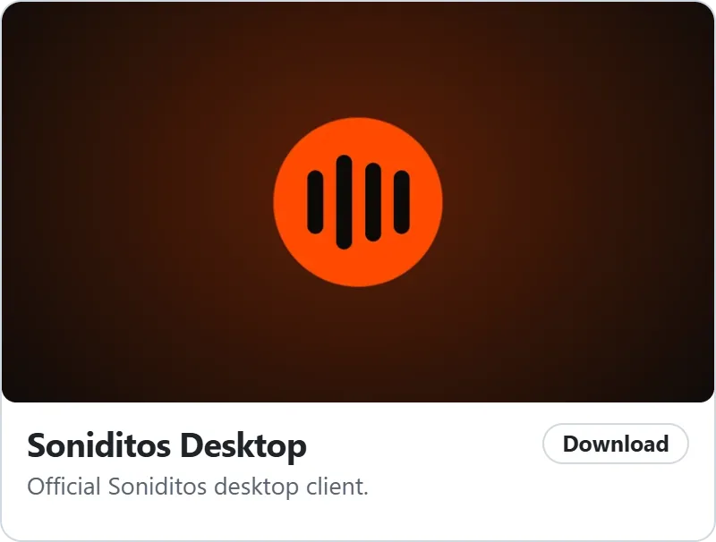</picture></a>

<b>🧰 All projects, with code</b>

 

| Since | Project | What it does | |
|:--|:--|:--|:--|
| 2026&#8209;11 | [**Parkour Template**](https://github.com/virtuanista/parkour-template) | Third-person parkour template to start your game. | [Details](https://virtuanista.github.io/en/#parkour) |
| 2026&#8209;11 | [**DataMiner**](https://github.com/virtuanista/data-miner) | Searches up to 45 sources at once, extracts the content and downloads the files. | [Details](https://virtuanista.github.io/en/#dataminer) |
| 2026&#8209;11 | [**Knowledge Atlas**](https://github.com/virtuanista/knowledge-atlas) | Six fractal graphs with 5,958 sources. Opens on OSINT. | [Details](https://virtuanista.github.io/en/#atlas) |
| 2026&#8209;11 | [**Vision**](https://github.com/virtuanista/vision) | An interface made only of Gaussian points. | [Details](https://virtuanista.github.io/en/#vision) |
| 2026&#8209;11 | [**Prisma**](https://github.com/vxtop/prisma) | Talk and work with Claude in a 3D space. | [Details](https://virtuanista.github.io/en/#prisma) |
| 2026&#8209;11 | [**GameHub**](https://github.com/virtuanista/gamehub) | Local workspace to produce a complete video game. | [Details](https://virtuanista.github.io/en/#gamehub) |
| 2026&#8209;11 | [**CENIZA: Protocolo Bastión**](https://github.com/virtuanista/ceniza-protocolo-bastion) | First-person wave survival shooter. | [Details](https://virtuanista.github.io/en/#ceniza) |
| 2026&#8209;11 | [**vxtop**](https://github.com/vxtop/vxtop) | A read-only 3D observatory of your computer. | [Details](https://virtuanista.github.io/en/#vxtop) |
| 2026&#8209;11 | [**Retro Fantasy Shooter**](https://github.com/virtuanista/retro-fantasy-shooter) | 8-bit shoot'em up with 7 zones and 8 bosses. | [Details](https://virtuanista.github.io/en/#retro) |
| 2026&#8209;11 | [**MYRMEX**](https://github.com/virtuanista/myrmex) | Real-time strategy with ant colonies. | [Details](https://virtuanista.github.io/en/#myrmex) |
| 2026&#8209;11 | [**Isleta**](https://github.com/virtuanista/isleta) | Build and decorate your own island. | [Details](https://virtuanista.github.io/en/#isleta) |
| 2026&#8209;10 | [**agent-test**](https://github.com/virtuanista/agent-test) | Autonomous web research agent without paid services. | [Details](https://virtuanista.github.io/en/#agent) |
| 2026&#8209;09 | [**Merge PDF**](https://github.com/virtuanista/unir-pdf) | Merges several PDFs from a local page. | [Details](https://virtuanista.github.io/en/#pdf) |
| 2026&#8209;07 | [**NEON ARENA**](https://github.com/virtuanista/neon-arena) | Real-time multiplayer 2D PvP shooter. | [Details](https://virtuanista.github.io/en/#neon) |
| 2026&#8209;05 | [**QR generator**](https://github.com/virtuanista/qr-code) | QR codes with colours, shapes and a logo. | [Details](https://virtuanista.github.io/en/#qr) |
| 2025&#8209;08 | [**Soniditos Desktop**](https://github.com/soniditos/soniditos-desktop) | Official Soniditos desktop client. | [Details](https://virtuanista.github.io/en/#soniditos) |
| 2025&#8209;07 | [**Node Criteria**](https://github.com/virtuanista/node-criteria) | Explains a concept with a local model and saves it as Markdown. | [Details](https://virtuanista.github.io/en/#node-criteria) |
| 2025&#8209;05 | [**Vector Explorer**](https://github.com/virtuanista/vector-explorer) | Extracts the embeddings of a language model and explores them in 3D. | [Details](https://virtuanista.github.io/en/#vector-explorer) |
| 2025&#8209;04 | [**ChatGPT Walker**](https://github.com/virtuanista/chatgpt-walker) | Turns your ChatGPT export into Markdown files for Obsidian. | [Details](https://virtuanista.github.io/en/#chatgpt-walker) |
| 2025&#8209;02 | [**Feelings Classifier**](https://github.com/virtuanista/feelings-classifier) | Classifies a text as positive or negative in a few lines. | [Details](https://virtuanista.github.io/en/#feelings) |
| 2025&#8209;02 | [**LLMQL**](https://github.com/virtuanista/llmql) | Ask a database in Spanish or English and get the SQL query and its result. | [Details](https://virtuanista.github.io/en/#llmql) |
| 2025&#8209;02 | [**Password generator**](https://github.com/virtuanista/password-generator) | Secure passwords in the terminal or the browser. | [Details](https://virtuanista.github.io/en/#password) |

## 📊 In numbers

<picture>
<source media="(prefers-color-scheme: dark)" srcset="https://virtuanista.github.io/img/perfil/cifras-oscuro-en.svg">

</picture>

	Repository made by <a href="https://github.com/virtuanista" target="_blank">virtu 🎣</a>

	

	Copyright &copy; 2026

