

<b>Español</b> · <a href="README.en.md">English</a>

<a href="https://mogub.app/"><picture><source media="(prefers-color-scheme: light)" srcset="img/mogub-claro.webp">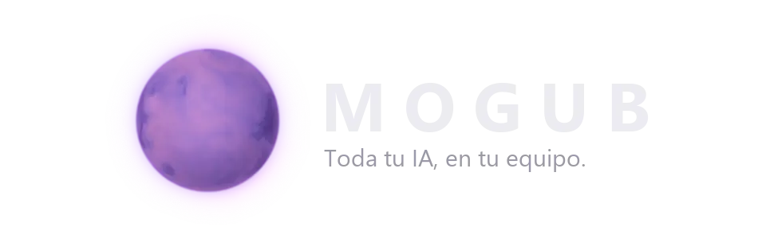</picture></a>

 

### Desarrollo · Tecnología · Inteligencia Artificial

Explora mis proyectos, tecnologías, desarrollos, últimos avances y próximas tareas.

## 🎮 Destacados

Del más nuevo al más antiguo.

<a href="https://virtuanista.github.io/parkour-template/"><picture><source media="(prefers-color-scheme: dark)" srcset="img/parkour-oscuro.webp">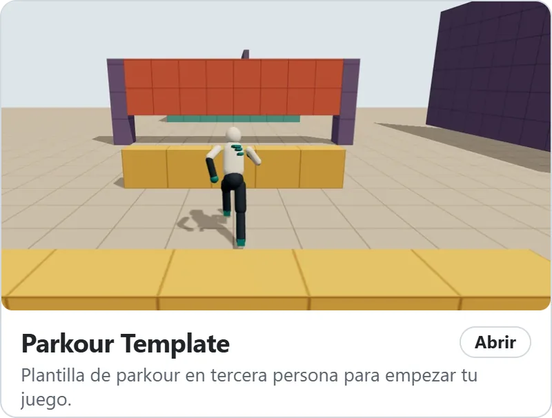</picture></a>
<a href="https://virtuanista.github.io/ceniza-protocolo-bastion/"><picture><source media="(prefers-color-scheme: dark)" srcset="img/ceniza-oscuro.webp">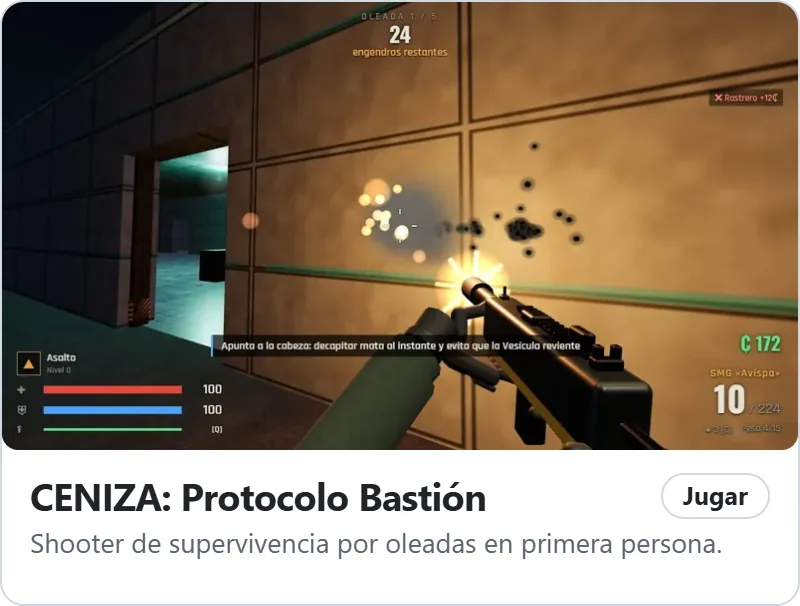</picture></a>
<a href="https://virtuanista.github.io/retro-fantasy-shooter/"><picture><source media="(prefers-color-scheme: dark)" srcset="img/retro-oscuro.webp">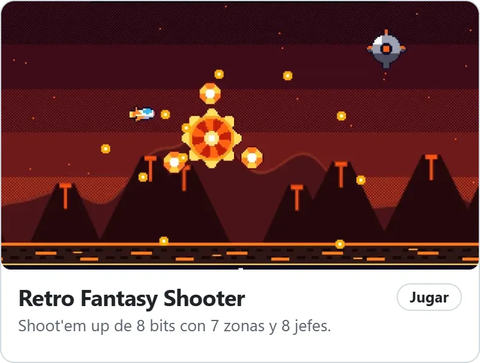</picture></a>
<a href="https://virtuanista.github.io/myrmex/"><picture><source media="(prefers-color-scheme: dark)" srcset="img/myrmex-oscuro.webp">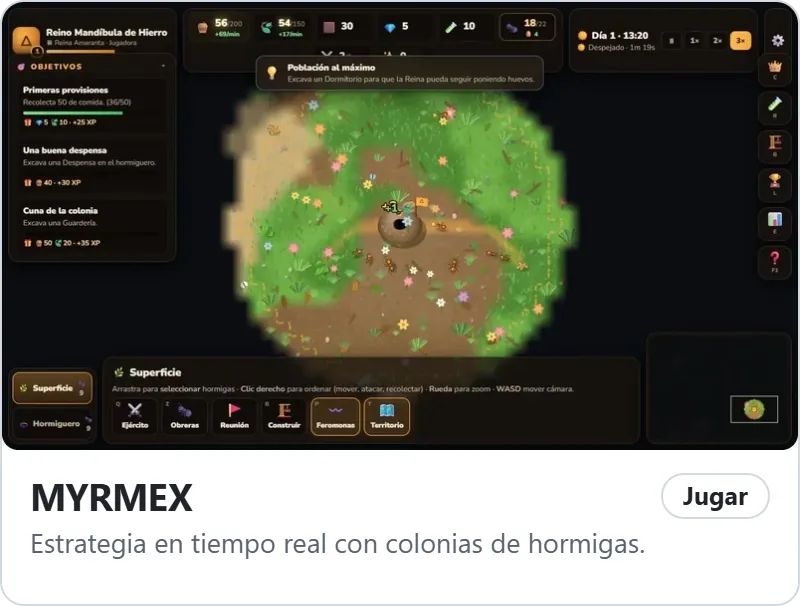</picture></a>
<a href="https://virtuanista.github.io/isleta/"><picture><source media="(prefers-color-scheme: dark)" srcset="img/isleta-oscuro.webp">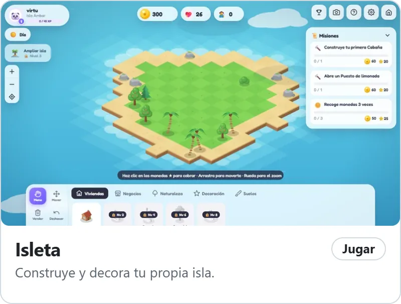</picture></a>
<a href="https://github.com/virtuanista/neon-arena"><picture><source media="(prefers-color-scheme: dark)" srcset="img/neon-oscuro.webp">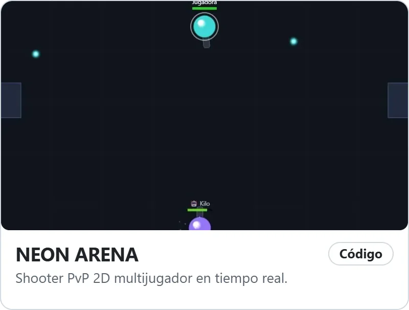</picture></a>

## 🧊 Herramientas, IA y 3D

<a href="https://virtuanista.github.io/data-miner/"><picture><source media="(prefers-color-scheme: dark)" srcset="img/dataminer-oscuro.webp">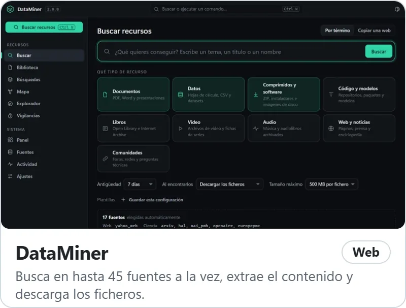</picture></a>
<a href="https://virtuanista.github.io/knowledge-atlas/"><picture><source media="(prefers-color-scheme: dark)" srcset="img/atlas-oscuro.webp">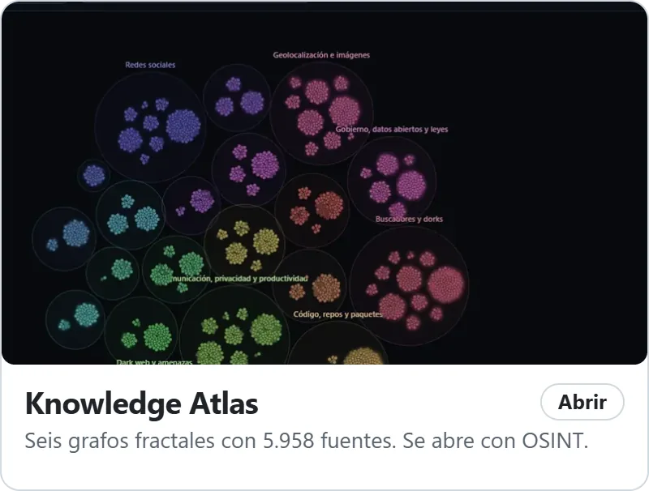</picture></a>
<a href="https://vxtop.github.io/prisma/"><picture><source media="(prefers-color-scheme: dark)" srcset="img/prisma-oscuro.webp">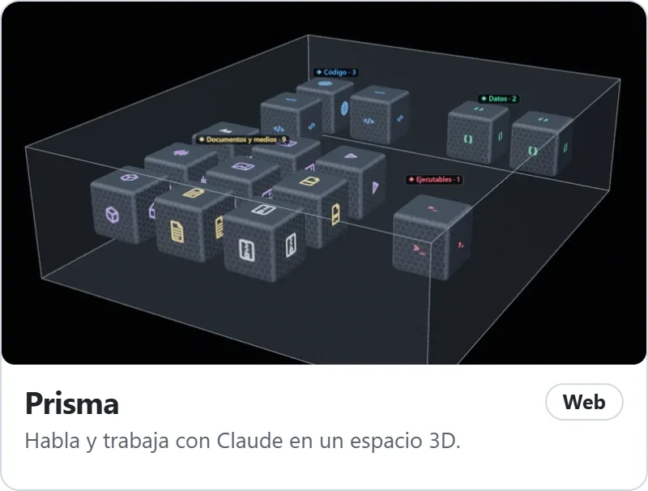</picture></a>
<a href="https://github.com/virtuanista/gamehub"><picture><source media="(prefers-color-scheme: dark)" srcset="img/gamehub-oscuro.webp">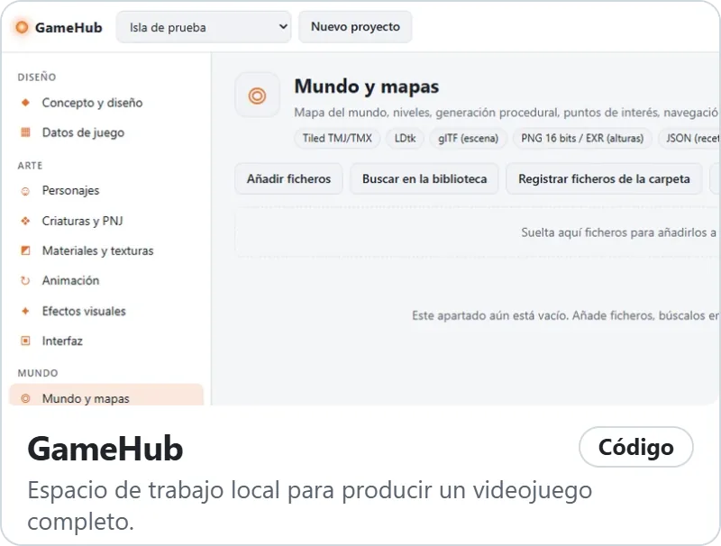</picture></a>
<a href="https://vxtop.github.io/"><picture><source media="(prefers-color-scheme: dark)" srcset="img/vxtop-oscuro.webp">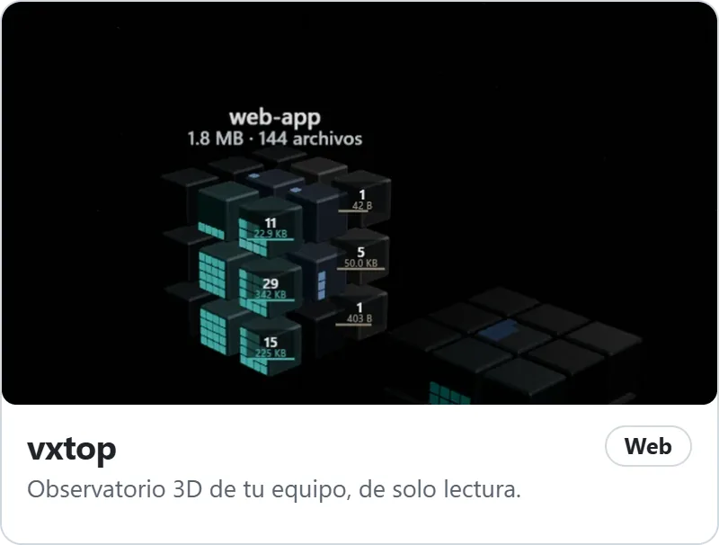</picture></a>
<a href="https://github.com/soniditos/soniditos-desktop/releases/latest"><picture><source media="(prefers-color-scheme: dark)" srcset="img/soniditos-oscuro.webp">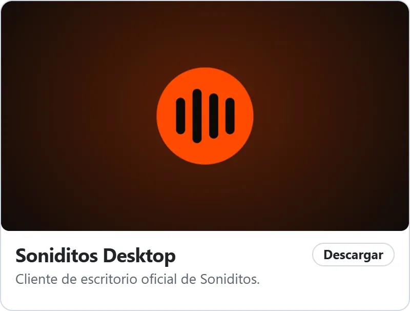</picture></a>

<b>🧰 Todos los proyectos, con su código</b>

 

| Desde | Proyecto | Qué hace | |
|:--|:--|:--|:--|
| 2026&#8209;11 | [**Parkour Template**](https://github.com/virtuanista/parkour-template) | Plantilla de parkour en tercera persona para empezar tu juego. | [Ficha](https://virtuanista.github.io/#parkour) |
| 2026&#8209;11 | [**DataMiner**](https://github.com/virtuanista/data-miner) | Busca en hasta 45 fuentes a la vez, extrae el contenido y descarga los ficheros. | [Ficha](https://virtuanista.github.io/#dataminer) |
| 2026&#8209;11 | [**Knowledge Atlas**](https://github.com/virtuanista/knowledge-atlas) | Seis grafos fractales con 5.958 fuentes. Se abre con OSINT. | [Ficha](https://virtuanista.github.io/#atlas) |
| 2026&#8209;11 | [**VISION**](https://github.com/virtuanista/vision) | Una interfaz hecha solo de puntos. | [Ficha](https://virtuanista.github.io/#vision) |
| 2026&#8209;11 | [**Prisma**](https://github.com/vxtop/prisma) | Habla y trabaja con Claude en un espacio 3D. | [Ficha](https://virtuanista.github.io/#prisma) |
| 2026&#8209;11 | [**GameHub**](https://github.com/virtuanista/gamehub) | Espacio de trabajo local para producir un videojuego completo. | [Ficha](https://virtuanista.github.io/#gamehub) |
| 2026&#8209;11 | [**CENIZA: Protocolo Bastión**](https://github.com/virtuanista/ceniza-protocolo-bastion) | Shooter de supervivencia por oleadas en primera persona. | [Ficha](https://virtuanista.github.io/#ceniza) |
| 2026&#8209;11 | [**vxtop**](https://github.com/vxtop/vxtop) | Observatorio 3D de tu equipo, de solo lectura. | [Ficha](https://virtuanista.github.io/#vxtop) |
| 2026&#8209;11 | [**Retro Fantasy Shooter**](https://github.com/virtuanista/retro-fantasy-shooter) | Shoot'em up de 8 bits con 7 zonas y 8 jefes. | [Ficha](https://virtuanista.github.io/#retro) |
| 2026&#8209;11 | [**MYRMEX**](https://github.com/virtuanista/myrmex) | Estrategia en tiempo real con colonias de hormigas. | [Ficha](https://virtuanista.github.io/#myrmex) |
| 2026&#8209;11 | [**Isleta**](https://github.com/virtuanista/isleta) | Construye y decora tu propia isla. | [Ficha](https://virtuanista.github.io/#isleta) |
| 2026&#8209;10 | [**agent-test**](https://github.com/virtuanista/agent-test) | Agente autónomo de investigación web sin servicios de pago. | [Ficha](https://virtuanista.github.io/#agent) |
| 2026&#8209;09 | [**Unir PDF**](https://github.com/virtuanista/unir-pdf) | Une varios PDF desde una página local. | [Ficha](https://virtuanista.github.io/#pdf) |
| 2026&#8209;07 | [**NEON ARENA**](https://github.com/virtuanista/neon-arena) | Shooter PvP 2D multijugador en tiempo real. | [Ficha](https://virtuanista.github.io/#neon) |
| 2026&#8209;05 | [**Generador QR**](https://github.com/virtuanista/qr-code) | Códigos QR con colores, formas y logo. | [Ficha](https://virtuanista.github.io/#qr) |
| 2025&#8209;08 | [**Soniditos Desktop**](https://github.com/soniditos/soniditos-desktop) | Cliente de escritorio oficial de Soniditos. | [Ficha](https://virtuanista.github.io/#soniditos) |
| 2025&#8209;07 | [**Node Criteria**](https://github.com/virtuanista/node-criteria) | Explica un concepto con un modelo local y lo guarda en Markdown. | [Ficha](https://virtuanista.github.io/#node-criteria) |
| 2025&#8209;05 | [**Vector Explorer**](https://github.com/virtuanista/vector-explorer) | Extrae los embeddings de un modelo de lenguaje y los explora en 3D. | [Ficha](https://virtuanista.github.io/#vector-explorer) |
| 2025&#8209;04 | [**ChatGPT Walker**](https://github.com/virtuanista/chatgpt-walker) | Convierte tu exportación de ChatGPT en archivos Markdown para Obsidian. | [Ficha](https://virtuanista.github.io/#chatgpt-walker) |
| 2025&#8209;02 | [**Feelings Classifier**](https://github.com/virtuanista/feelings-classifier) | Clasifica un texto como positivo o negativo en pocas líneas. | [Ficha](https://virtuanista.github.io/#feelings) |
| 2025&#8209;02 | [**LLMQL**](https://github.com/virtuanista/llmql) | Pregunta a una base de datos en español o inglés y obtén la consulta SQL y su resultado. | [Ficha](https://virtuanista.github.io/#llmql) |
| 2025&#8209;02 | [**Generador de contraseñas**](https://github.com/virtuanista/password-generator) | Contraseñas seguras en la terminal o en el navegador. | [Ficha](https://virtuanista.github.io/#password) |

## 📊 En cifras

<picture>
<source media="(prefers-color-scheme: dark)" srcset="https://virtuanista.github.io/img/perfil/cifras-oscuro.svg">

</picture>

	Repositorio generado por <a href="https://github.com/virtuanista" target="_blank">virtu 🎣</a>

	

	Copyright &copy; 2026

